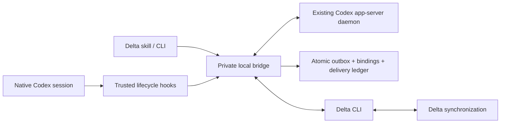

# Architecture

`src/main.ts` is the executable entry point. The release bundles it into
`dist/cli.js`; `bin/delta-codex.mjs` is a stable launcher. All dependencies are
build/test dependencies. Plugin hook trust covers the launcher and bundled
executable; do not turn the launcher into a downloader.

`src/ipc.ts` owns one bridge per Codex profile. Hooks are short-lived clients of
that bridge. An exclusive process lock prevents two writers, and a private
socket or named pipe plus a random local token limits access to the profile's
owner. State and endpoint files are written with private permissions. IPC accepts
named operations, not arbitrary shell commands or app-server RPC.

`src/codex/rpc.ts` connects through `codex app-server proxy` to the existing
daemon. It initializes the protocol, tracks correlated responses, bounds frames,
and rejects pending requests on disconnect. It never starts a replacement
harness to claim control over a different Codex process. History uses pagination
and an explicit legacy fallback for unsupported APIs. Initial hydration reads
all retained turns; polling reads back from the newest turn to the previous
anchor. Tool approvals stay pending for explicit answers.

`src/bridge.ts` owns session lifetimes, mount processes, watches and permissions.
It imports shared history, activates bindings, reconciles producer frontiers,
delivers collaborator context at idle, and interrupts superseded turns.
Starting or reading a session does not imply starting a model turn. Only the
explicit background-run operation calls `turn/start`.

`src/cli/delta.ts` is the Delta process boundary. Arguments are arrays, never
shell-expanded strings. The CLI owns account authentication, organization state,
storage, worktree synchronization and merge behavior. The adapter validates
contract, status, mount, watch and append responses. Unknown watch event types
are skipped; malformed known events reconnect with a diagnostic.

## Recording invariants

1. A native Codex ID maps to one Delta producer: `--source codex --external-id ID`.
2. Thread identity and checkout reference are saved before dependent operations.
3. Sequence allocation, content fingerprints and pending records are one atomic
   transaction. A write uses a private temporary file, file fsync, rename and
   directory fsync where supported. No unpersisted record is sent.
4. Delivery removes only a validated acknowledged prefix. Failed and ambiguous
   requests keep the original bytes and sequence numbers. Permanent errors pause;
   transient errors respect retry hints and exponential backoff.
5. Live turns retain their original `turnSequence`, including late output after
   fencing. Supersession requests cancellation of that exact native turn.
6. Historical turns do not take ownership of a live Delta turn. Retained native
   child histories can be imported after the child has ended.
7. Unknown/deleted state is never treated as a fresh sequence frontier for the
   same producer. A mismatch requires recovery or a new native session.

`src/recording/translate.ts` maps public Codex items to ACP updates. It excludes
hook/system/developer context and imported collaborator messages to prevent
feedback loops. `images.ts` embeds only user-attached local images with recognized
signatures and a size bound, not arbitrary paths in tool output.

## Receiving collaboration

The adapted `RemoteView` keeps the Delta snapshot, streaming replacements,
comments, edit/removal corrections, and a persisted delivery ledger. Remote
thinking is excluded from model context. Snapshot context is bounded to 80,000
characters with omission notices; full history remains available through the
Delta CLI. Large individual sections retain the reference adapter's explicit
truncation notices.

Rows enter native context with `thread/inject_items` as labeled user-level
collaboration data. No `turn/start` or `turn/steer` is used for passive delivery.
A successful injection precedes ledger persistence; a crash in between can
repeat a labeled row. This is an at-least-once context delivery boundary, not an
exactly-once execution claim.

## Mount and shutdown ownership

The bridge keeps `worktree mount --existing-checkout` alive for owned sessions,
or `thread mount --owner ID` for joins. Attachment changes prepare a replacement
before releasing the previous mount. A join does not export its caller's history
or attach the caller's checkout. It records under the new native session ID.

Normal session end releases resources while preserving the binding for resume.
An explicit stop opts the session out of further recording, even under an
automatic repository policy. Parent shutdown also releases inherited recording.
Joined active turns are interrupted before mount release. Delta remains
responsible for retaining a checkout whose pending upload could not finish.

The bridge is local to a profile. It intentionally does not copy API keys,
configure authentication, change hook trust, or edit Codex's database.
