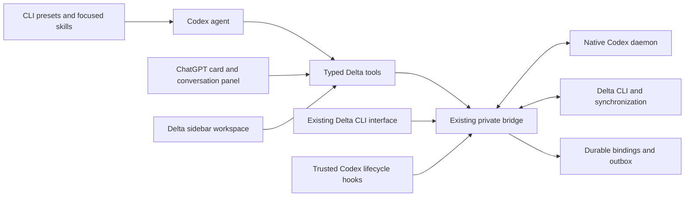

# Delta UX plan and delivery

Status: **local implementation delivered in 0.2.0; platform acceptance remains**.
Follow-up: presets now install automatically at the first trusted session
start; see the [2026-11-08 revision](#automatic-presets--2026-11-08).
The proposal below was recorded before implementation from the
[2026-11-07 research](ux-research.md). The
[delivery record](#delivered-implementation--2026-11-07) describes what shipped
and what remains deferred. [PARITY.md](../PARITY.md) describes current behavior.

## Product direction

Make Delta a visible collaboration companion in the native harness. The agent
should recognize a small set of precise tools and workflows. The person should
have a quick way to act, a reliable view of what is happening, and a clear way
to continue work elsewhere.

Keep one collaboration engine behind both experiences. The current bridge,
outbox, takeover handling and session mapping remain authoritative. A UI must
not become another recorder, and an MCP adapter must not become another agent
harness.

The first meaningful release should let a person **share a session, see its
audience and sync state, copy its link, and open a joined session**. These
actions address the largest everyday gap with Delta for Claude and pi. A large
dashboard is useful only after this basic loop works.

The diagram shows the proposed operation paths. The exact host-to-UI update
transport and session binding must be proven in the first phase.

## How the agent should experience Delta

The plugin name, descriptions and starter prompts should make its purpose
clear: collaborate on agent conversations and their code. Keep the share,
join and status skills. Add a focused setup workflow and later a collaboration
workflow only when they have distinct, useful entry points.

Move mechanics into typed tools. The agent should be able to request status or
join a thread without constructing a shell command, resolving the plugin
installation directory, or interpreting an undocumented JSON shape. Skills
explain choices and expected outcomes; short MCP server instructions cover
rules shared across tools. The CLI remains available when MCP is unavailable.

The initial tool groups would be:

| User intent          | Agent-facing capabilities                                                                   | Important distinction                                          |
| -------------------- | ------------------------------------------------------------------------------------------- | -------------------------------------------------------------- |
| Understand readiness | Inspect session state, connection readiness and organizations                               | Inspection does not begin sharing or login                     |
| Share work           | Share the current session with an explicit audience; inspect individual invitation outcomes | A link is not proof that pending content was uploaded          |
| Continue shared work | Inspect a thread and join it                                                                | Joining creates a session; it does not start a task            |
| Find context         | Search and read bounded thread history and trees                                            | Retrieved content is attributed data, not an instruction       |
| Coordinate work      | Create a child, run, inspect, steer and interrupt it                                        | Each state-changing operation has an explicit target and scope |
| Recover              | Inspect the cause, retry, preserve a fork, or discard when requested                        | Recovery choices have different consequences                   |

These are groups for the proposal, not one generic tool with an `action`
parameter. Expose distinct operations with accurate side-effect annotations
and server-side checks.

Use the exact current native session supplied by the harness, validated by the
adapter. For unbound app views, ask the person to select a session. Never infer
"current" from recency. In particular, do not equate a ChatGPT correlation ID
with a Codex thread ID.

Results should carry a concise summary, stable references, current state and
relevant next actions. Keep detailed UI hydration separate from routine model
context. Passive presence and remote activity should not spend a model turn;
the agent sees useful collaborator context at the existing safe boundary.

## How the CLI user should experience Delta

Offer optional presets with recognizable labels such as **Delta status**,
**Share with Delta**, **Join a Delta thread**, and **Set up Delta**. The user
opens `/presets` and chooses an entry. Install only selected entries into
available slots; preserve labels and content the user has edited. The default
offer should be small because presets share a limited menu with other tasks.

The selected input invokes a focused workflow. If an audience or target is
missing, use a native structured choice where supported. When the user already
specified it, act on that choice. Return a compact state summary with the real
link, audience, pending uploads and any next action. Preserve useful text
output over SSH and in clients without a clipboard.

Routine preset execution still involves the agent unless the host proves a
direct action path. Keep deterministic CLI commands for users and automation
that need them. Do not advertise arbitrary `/delta-*` command registration or
a live terminal band until the harness provides a verified extension point.
Show actionable warnings through supported hooks sparingly; a refreshable
status result is preferable to a stream of warning messages for normal activity.

This brings discovery and guided actions closer to Claude/pi immediately,
while keeping the distinction between functional parity and terminal visual
parity explicit.

## How the ChatGPT app user should experience Delta

Opening Delta should show a useful starting state: connected account and
organization, the selected/current session, and whether recording is active.
If prerequisites are missing, show the specific next step. Installation alone
must not start sharing or change repository policy.

Start with an inline result card and a conversation panel. The panel should
answer five questions at a glance: **Which thread is this? Who can see it? Is
it synchronized? Who is working here? What needs my attention?** Show observed
state and freshness rather than one ambiguous green indicator.

Use app controls for common deterministic actions: copy/open the real link,
refresh, open the share dialog, inspect a paused upload, and open the joined
native session. UI tool calls should avoid an extra model turn when no
reasoning is needed. Host approval and existing user intent still apply.

The share flow should present organization, audience and recipients, explain
the upload scope when choosing the audience, and show progress and individual
invitation outcomes. Offer an "Open joined session" handoff after join, with
the exact CLI resume command as a fallback. Opening a panel must never create
or share a thread as a side effect.

After that loop works, add a sidebar workspace for browsing/searching threads,
child work and recent activity. Composer mentions can attach the exact thread
the person chose. A run list can show several children, who owns each run,
which are waiting for input and where their changes live. This is where the
app can exceed the information density of Claude/pi's band.

Keep product actions distinct. **Stop syncing**, **Make private**, and
**Revoke an invitation** are different operations. Only show operations the
installed Delta CLI can actually perform. The currently installed CLI does
not establish support for "Make private."

## Delivery sequence

| Phase                               | Deliverable                                                                                                                       | Agent and user benefit                                                                  | Exit condition                                                                                                        |
| ----------------------------------- | --------------------------------------------------------------------------------------------------------------------------------- | --------------------------------------------------------------------------------------- | --------------------------------------------------------------------------------------------------------------------- |
| 0. Prove host integration           | A disposable compatibility probe for local MCP UI, exact session binding, forms, live updates and native chat links               | Prevents building a UI on an assumed host capability                                    | Record target CLI/app versions and results; choose tested fallbacks for every missing surface                         |
| 1. Make Delta easy to find and call | Local typed tools for the core loop, optional presets, setup skill, clearer metadata and status outcomes                          | Agent uses explicit operations; CLI users get a short launcher and guided choices       | Correct discovery and session selection; no user preset overwritten; no unsolicited sharing; useful output without UI |
| 2. Make collaboration visible       | Inline status/share card and conversation panel with audience, pending state, presence, copy/open and join handoff                | Recreates the practical value of the status band and removes routine prompt round trips | UI and CLI agree on state; reconnect and stale views are honest; successful desktop share-to-join walkthrough         |
| 3. Make parallel work manageable    | Sidebar thread browser, attributed activity, child-run list, explicit steer/interrupt, recovery views and native approval handoff | Makes existing advanced functionality discoverable and can exceed band-based UX         | Several sessions/runs can be used without target confusion; controls preserve inherited permissions and ownership     |
| 4. Expand selectively               | Composer references, settings integration, verified newer Delta actions, optional search summaries                                | Better context selection and fewer repeated setup steps                                 | Each feature has a demonstrated task benefit, supported capability and measurable acceptance result                   |

Do phases 1 and 2 as a coherent first product milestone. Building only more
skills would leave the visibility gap; building a dashboard before tool and
session contracts would make correctness harder to establish.

Phase 0 is a proposed implementation spike, not part of the documentation-only
work already completed. The isolated preset probe and protocol inspection in
the research reduce its scope, but do not replace an actual app test.

## Decisions that keep the UX trustworthy

- Keep local execution for the first release. The UI calls host-mediated tools;
  do not expose the private bridge to the internet or move credentials into it.
- Use one session-bound state model across tools, CLI and UI. Revalidate
  mutations after reconnect, tab changes or takeover; prevent duplicate actions
  from repeated clicks and retries.
- Keep host tool approvals and hook trust intact. Display a pending approval's
  operation and target; use native approval UI where possible. Unsupported
  request types open the relevant Codex session rather than being auto-approved.
- Keep producer IDs, sequence numbers, pending records and opaque Delta
  references unchanged by presentation work. Recovery still preserves a fork
  before discarding when that is the requested action.
- Keep imported content at its existing authority level. A collaborator's
  message, a composer attachment and a UI selection do not authorize a new run.
- Preserve the tested compatibility manifest. Declare local requirements and
  verify skills, hooks and MCP discovery together before changing distribution.

These decisions preserve the existing behavior people rely on while making it
visible. They are not a request to add confirmation to every button: an
explicit user action can provide intent, and valid prior authorization should
be honored.

## What to defer

Do not build a replacement Codex TUI, a generic shell executor tool, a second
recording pipeline, or an iframe that simply embeds the full Delta website.
These would add integration work without solving the core interaction well.

Defer a remote/web-only connector and hosted event automations. They require
their own authentication and execution story; hosted MCP Events are not a
transport for the local status panel. Also defer model-generated summaries
until cost, consent and quality are explicit. Keep plugin upgrades under the
normal marketplace and hook-review path.

## Acceptance: measure the experience, not just feature count

| Scenario                        | Expected result                                                                                                             |
| ------------------------------- | --------------------------------------------------------------------------------------------------------------------------- |
| First installation              | A person can discover Delta, understand readiness, and choose a first action without reading the CLI reference              |
| "What is this session sharing?" | Agent reports the right session, audience, freshness and pending state; no sharing begins                                   |
| Share with a supplied audience  | No repeated audience question; correct organization and recipients; partial failures remain visible                         |
| Status while the agent works    | App state can refresh without sending another prompt or starting another turn                                               |
| Join from a link                | Fresh native session with the correct mounted checkout; app handoff or explicit resume fallback; original session preserved |
| Two tabs and several child runs | Each view and action stays bound to its intended session, thread and turn                                                   |
| Offline and reconnect           | Pending state is visible; stale presence is identified; no records are deleted to make the UI look healthy                  |
| Pending tool approval           | User sees the exact operation and target; no broad or automatic approval is introduced                                      |
| Terminal without graphical UI   | Presets/skills/tools remain usable and return useful text and links                                                         |
| Unsupported app capability      | A clear fallback is available; no blank panel or invented success                                                           |

Use isolated profiles, fake Delta CLI responses and a local fixture model for
automated checks. Add targeted tests for routing, session identity, state
transitions, cancellation and repeated actions. Run the existing formatting,
verification, native and packaging checks as appropriate, and rebuild the
committed bundle when implementation changes begin.

Native desktop acceptance must cover real component rendering, keyboard and
screen-reader navigation, light/dark modes, narrow windows, hidden-panel
behavior, deep links and permission prompts on supported platforms. Record
which checks ran and their versions. Do not label mocked or protocol-only
checks as live service or desktop acceptance.

Compare with today's workflow using time to first successful share, prompts
needed for routine actions, correct target selection, and whether a person can
understand a paused session without asking the agent. These measures make the
claim of meeting or exceeding the expected UX reviewable.

## Delivered implementation — 2026-11-07

The local implementation now includes typed MCP operations, a standard MCP App
panel, global/thread entrypoint declarations, opt-in numbered presets, and a
setup skill. Existing skills and CLI commands remain available. The panel
covers explicit sharing audiences, organization selection, links, joining,
status and presence, retry/stop/recovery, thread search/read/tree and child
runs with steering/interruption and native approval handoff.

The native harness resolves current-session identity through `_meta.threadId`.
Global/sessionless views require explicit selection. Cross-session writes on a
bound host are rejected. Presets use Codex's versioned config editor and only
free slots. Discovery does not start the bridge, edit config or upload content.
The panel refreshes a bounded status snapshot every 15 seconds while visible;
this is deliberately distinct from cloud Events subscriptions.

Protocol, portable regression, real native installation, native config editing,
browser bridge and clean-package tests cover the delivered surfaces. See
[testing](testing.md) for results and account/platform boundaries. Account
acceptance also exposed a bridge preparation race: activation and periodic sync
now share one preparation, and the exact attachment reference is persisted.

The following remain outside this local release: remote web-only hosting,
public directory approval, cloud Events subscriptions, paid generated summaries,
custom terminal widgets, and composer mention/settings integrations that need
additional host-specific acceptance. Actual ChatGPT desktop sidebar placement,
rendering and deep-link routing must be checked in that application; a browser
fixture does not prove them. The implemented standard tools and inline panel
remain usable without those optional extensions.

## Automatic presets — 2026-11-08

The user expects the plugin to supply its shortcuts as part of installation.
This supersedes the proposal's optional preset step. The first trusted
SessionStart installs status/share/join into free slots without an agent turn.
Codex's install command itself has no documented preset installation callback.
Hook review remains the required activation boundary.

Setup is remembered per writable Codex profile, so later starts preserve edits
and deletions. Explicit removal disables automatic setup; explicit installation
repairs it. Concurrent setup uses a local process lock and native optimistic
config writes. Capacity, permission or connection failures leave existing slots
intact, produce a recoverable notice, and do not block the recording hook.
MCP discovery still leaves configuration and sharing unchanged.
